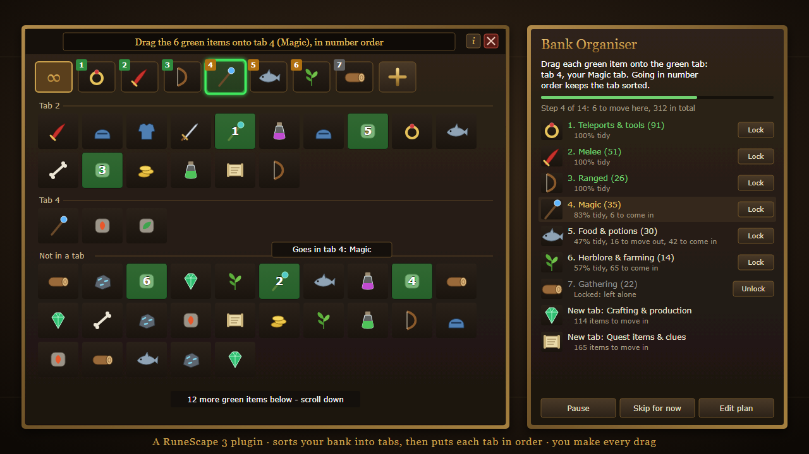

<p align="center">
  
</p>

<h1 align="center">Bank Organiser</h1>

<p align="center">
  <b>A RuneScape 3 plugin that sorts your bank into sensible tabs, then puts every tab in order.</b><br>
  It shows you what to move and where. You make every drag.
</p>

<p align="center">
  <a href="https://itsdpraven.github.io/rs3-bank-organiser/"><b>Website</b></a> ·
  <a href="https://github.com/itsdpraven/rs3-bank-organiser/releases/latest">Latest release</a> ·
  <a href="https://mod.io/g/runescape/m/bank-organiser">mod.io</a>
</p>

---

## What it does

Most banks end up as a few half-sorted tabs and hundreds of items in the main
tab. Bank Organiser works out where everything belongs and walks you through it,
one tab at a time, right on top of the real bank.

- **Highlights on your bank.** One colour code throughout: green means drag,
  yellow means drop here, blue means click. Items to move glow green, numbered
  in the order to drag them, and the tab to drop them on (or the **+** button
  for a new tab) is boxed in yellow and tagged "Drop here". When there's a
  single drag to make, a moving dotted trail runs from the item to where it
  goes. A banner across the bank says what to do, and after each drag tells
  you whether the item went to the right place.
- **Works on any bank size.** If the tab to drop on is scrolled out of the tab
  bar, the plugin points you to the arrow that brings it back. In a big tab,
  an item that has to travel further than fits on screen is moved part of the
  way first, so every drag starts and ends on screen.
- **Works from the bank you already have.** Tabs that already fit are kept,
  tabs that fit nothing are reused, and new tabs are only suggested when
  needed. Nothing is deleted. Locked tabs are never touched.
- **Puts the tabs themselves in order**, then **sorts inside each tab**:
  gear by level with each set together, runes in the usual order, potions by
  type from most doses to fewest, herbs grimy → clean → unfinished, logs before
  bows, ores before bars, quest items by quest.
- **Picks an icon for every tab** from your own items (the best weapon for
  Melee, your best food for Food & potions...). Fixing any tab whose icon item
  is in the tab but not at the front is always the first step, so every tab
  is easy to recognise from the start.
- **Open any single tab** to tidy just that tab: what belongs elsewhere is
  highlighted with the tab it goes to, then the tab is put in order (a setting).
- **Point at any bank item** to see which tab it belongs in. Items in your
  backpack show the number of their tab, so you can deposit into the right
  place.
- **Questions & answers** in the plugin window (the Q&A button) explain how
  items are placed and ordered, what the colours mean, and more.

## Your bank, your rules

- **Two modes:** *Organise my bank* (a full plan of up to 14 tabs) or *Just
  tidy my tabs* (keep your tabs, fix only what's clearly out of place).
- **Plan styles:** Recommended, Compact, Skiller and Simple, or your own.
- **Edit any tab:** rename it, move it, add or delete tabs, choose which kinds
  of item it holds, and send items by name to a tab (type a name or point at
  the item in your bank).
- **Lock** tabs you want left exactly as they are; **Skip for now** or click
  any tab to work on it next.

## How it decides where things go

Items are sorted mostly from the game's own data rather than guesswork:

1. your own rules (items by name, per tab);
2. what the game marks clearly: clue scrolls, Archaeology, Divination,
   holiday and outfit items, currencies and lamps, Summoning and Runecrafting
   supplies;
3. the item's **Grand Exchange category**: Jagex's own list for every
   tradeable item;
4. equipment by **combat style**, from its combat stats;
5. names and right-click options for anything left, and untradeable quest
   items.

On a real 986-item bank, about 99% of items get a specific category.

## Safe by design

- The plugin **never moves, clicks or drags anything**. It only draws
  click-through highlights and text. You do every action yourself.
- It requests **no permissions** and **sends nothing anywhere**.
- Settings, your plan and tab locks are saved only on your computer, and can be
  deleted from the plugin window at any time.

## Install

Once it's approved on the RuneScape Plugin Hub: open the Plugin Hub in game
(the toolbox icon), find **Bank Organiser**, install it, then turn it on in the
**Manage** tab. Open your bank, then the plugin window from its ribbon icon.

To try the development version, see [`bank-organiser/README.md`](bank-organiser/README.md).

## Repository layout

| Path | What's there |
|---|---|
| [`bank-organiser/`](bank-organiser/) | The plugin (what gets uploaded), its tests and its developer README |
| [`tools/`](tools/) | Builds the Plugin Hub upload zip and the listing image |
| [`listing/`](listing/bank-organiser/LISTING.md) | The mod.io listing text |
| [`docs/`](docs/) | Images for this page |
| `bank-organiser-probe/`, `bank-organiser-testkit/` | Development-only helper plugins (never uploaded) |

## Development

The plugin is plain Lua 5.4 and is tested outside the game:

```
cd bank-organiser
lua tests/run_tests.lua          # unit tests: sorting, plans, settings
lua tests/e2e/run_e2e.lua        # end-to-end tests
```

The end-to-end tests run the whole plugin against a stand-in for the game
client, with a simulated player who does only what the highlights show: it
finds the coloured boxes on screen, works out what's under them, and makes
that drag or click, until the bank is organised. They cover every plan style
and mode, locks, skipping, single tabs, a narrow tab bar, big tabs, wrong
drags, closing the bank part way, every control in the window, and random
banks (`--fuzz 500` for 500 of them).

The packaging script checks the plugin before building the upload:

```
powershell -ExecutionPolicy Bypass -File tools/package-bank-organiser.ps1
```

## Legal

Bank Organiser is a fan-made plugin and isn't made or endorsed by Jagex. Item images are from the [RuneScape Wiki](https://runescape.wiki).
RuneScape is a trademark of Jagex Ltd. Plugins on the official Plugin Hub are
provided under the [Jagex EULA](https://legal.jagex.com/docs/terms/eula), so
this repository has no separate licence.
